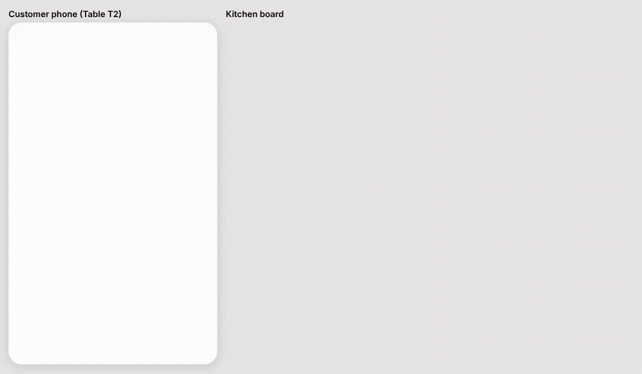
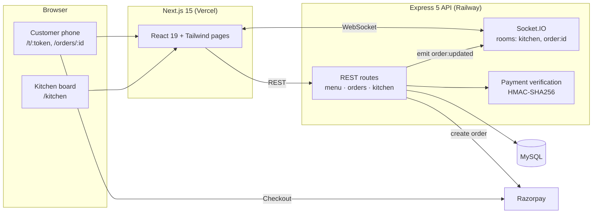

# TableTap: QR table ordering

Scan the QR on your restaurant table, order from your phone and pay with Razorpay. The kitchen board and your order tracker update **live** over WebSockets.



**Live demo:** _coming soon_

## Features
- **QR per table:** each table has an opaque token (`/t/<token>`), so table IDs can't be guessed.
- **Menu and cart:** mobile-first, with veg/non-veg markers and quantity controls.
- **Razorpay checkout (test mode):** the server creates the Razorpay order and verifies the HMAC-SHA256 signature before an order is marked paid.
- **Live kitchen board:** new orders appear instantly. Staff move them through *Preparing → Ready → Served*, and the customer's phone follows along in real time.
- **Server-side pricing:** prices are always read from the database, never from the client, so a tampered request can't change the bill.

## Architecture



### Order lifecycle
1. The customer submits the cart. `POST /api/orders` validates the items with Zod, prices them from MySQL, saves a `pending_payment` order and creates a Razorpay order, all in one transaction.
2. Razorpay Checkout runs in the browser and returns `payment_id` and `signature`.
3. `POST /api/orders/:id/verify` checks the signature. If it's valid, the order becomes `paid` and is broadcast to the `kitchen` room and the order's own room.
4. Kitchen staff click to advance the status. Each change is broadcast the same way.

### Data model
`dining_tables` · `categories` · `menu_items` · `orders` · `order_items`. Money is stored in paise (INT). Order items snapshot the name and price, so later menu edits don't rewrite past bills. See [`server/db/schema.sql`](server/db/schema.sql).

## Tech stack
Next.js 15 · React 19 · Tailwind CSS 4 · Express 5 · Node.js · MySQL · Socket.IO · Zod · Razorpay

## Run locally
```bash
# Database: MySQL 8 or MariaDB
cd server
cp .env.example .env          # set DB_* (Razorpay keys optional: without them payments run in mock mode)
npm install
npm run db:init               # creates tables and seeds the menu
npm run dev                   # API + Socket.IO on http://localhost:4000

cd ../web
cp .env.example .env.local
npm install
npm run dev                   # http://localhost:3000
```
Open http://localhost:3000, pick a table and place an order. Then open `/kitchen` in a second window.

## Deploy
**API + MySQL on Railway**
1. New project → *Deploy from GitHub repo* → set the root directory to `server`.
2. Add a **MySQL** service. In the API service's variables, set `DATABASE_URL=${{MySQL.MYSQL_URL}}`.
3. Add `CLIENT_ORIGIN=https://<your-app>.vercel.app` (comma-separate to allow several), plus `RAZORPAY_KEY_ID` and `RAZORPAY_KEY_SECRET`.
4. Run `npm run db:init` once (Railway shell or `railway run npm run db:init`).
5. Generate a public domain for the API.

**Web on Vercel**
1. Import the repo and set the root directory to `web`.
2. Set `NEXT_PUBLIC_API_URL=https://<your-api>.up.railway.app`, then deploy.

## Razorpay test payments
Use the test card `4111 1111 1111 1111` (any future expiry, any CVV) or the UPI ID `success@razorpay`.

## Roadmap (v2)
- Pay after the meal: one running bill per table session
- Admin login, menu editor and printable QR sheet
- Razorpay webhooks as a backup to client-side verification
- Automated tests and CI
